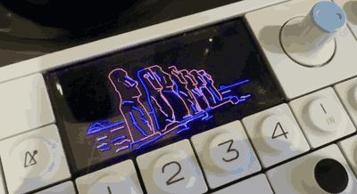
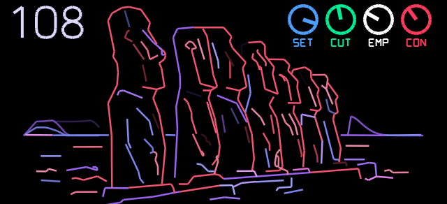
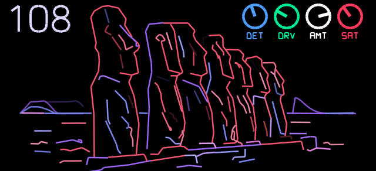
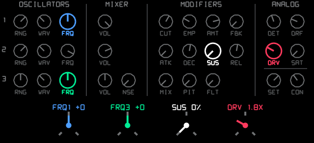
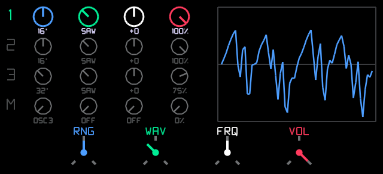
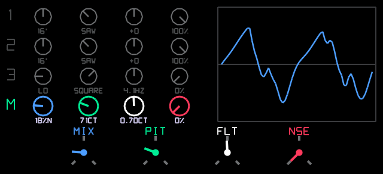
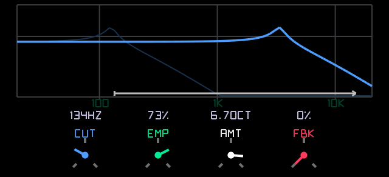
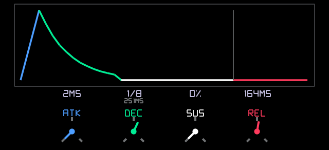
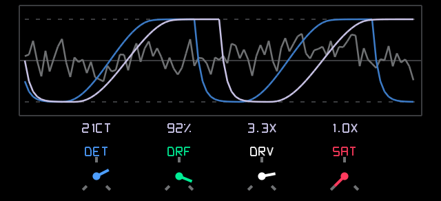

# Moai

A Minimoog-inspired synth for the Teenage Engineering OP-1.

*Ideally a video should demo the synth, but I have to learn how to make music first*.

[Download the latest release](https://github.com/fungiboletus/op-moai/releases). It *should* be compatible with modded firmwares such as op1r, hundekraft or opus. The installation procedure depends on your firmware.

## It Does and Does Not Sound like a Minimoog

Moai is not a very accurate emulation of a Minimoog. The OP-1 is a digital instrument, and the Minimoog analog sound is difficult to replicate without requiring advanced maths that the OP-1 can't do quickly enough.

Moreover, the author doesn't own a Minimoog. They had a Behringer D Mini that died before they started this project, and they played with many Moog-like VST synths. The favourite one being The Legend HZ. It's challenging to make a great emulation of an instrument without owning the instrument.

From the non-expert ears of the author, this is likely far off the real thing, but still cool and fun for the OP-1.

## Moai Is Monophonic First, but Should Be Usable in Polyphonic Mode

Some effort has been put into making it quick enough to run on the OP-1 under good conditions. Running Moai in monophonic mode, like a real Minimoog, should be perfectly fine.

UNISON and POLY use up to 6 voices, which can be a bit much depending on the other effects you run. If you use POLY or UNISON, consider disabling effects or using lightweight effects. Some new reverberation effects are somewhat heavy. The third oscillator is also disabled in UNISON and POLY. You may find tiny gains by disabling additional Moai features such as saturation and drive if you are running very close to the CPU limit.

As a reminder, you can switch between MONO, LEGATO, UNISON, and POLY by holding shift and pressing key 2 (the second key below the screen). You should be able to make interesting sounds in monophonic mode. And you can make simple chords by setting the frequencies of the 3 oscillators.

## Presets Are Kinda Broken

The OP-1 firmware has a limit of 7 settings per preset. Moai has 30 settings. Saving and loading presets only works on 7 settings: sound number, cutoff, emphasis, contour, detune, drive, and drift. Every other setting cannot be saved.

## Simple Manual

Moai can be used as a simple OP-1 synth without needing to know what you are doing.

- 🔵 Moai comes with more than one hundred **SET**s identified by a number. A bit like the factory DNA synth.
- 🟢 **CUT**off Frequency
- ⚪️ **EMP**hasis
- 🟠 Quick filter **CON**tour

## Advanced Manual

A Minimoog is a great synthesizer because it's relatively simple and straightforward, but also complex enough to have fun. And it can sound good.

If you are more into playing with synths than making music, you can spend time learning Minimoog sound design. This manual will not cover that.

A Minimoog has 28 knobs and 16 switches. Moai has 4 clickable knobs. So Moai uses modes, which you can select by clicking the knobs repeatedly.

- 🔵 Moai Default Screen
- 🔵 Full Settings View
- 🟢 Oscillator 1
- 🟢 Oscillator 2
- 🟢 Oscillator 3
- 🟢 Modulation and Noise
- ⚪️ Filter
- ⚪️ Filter Contour
- 🟠 Analog Settings

### Moai Default Screen

In addition to the simple manual's knob settings, you can change those values while holding shift.

- 🔵 **DET**une
- 🟢 **DR**i**V**e
- ⚪️ **AM**oun**T** of contour
- 🟠 **SAT**uration

### Full Settings View

All the settings are available in one screen, which can be convenient if you want to play with very different settings without switching mode, or connect LFOs to them. Please note that LFOs will edit the settings of the current screen.

You can change the highlighted setting of a knob by rotating the knob while holding shift.

All the settings are accessible in other modes; this view is only for convenience.

### Oscillators

You can switch between oscillators and modulation by clicking the green knob.

- 🔵 **R**a**NG**e: OFF, LO, 32', 16', 8', 4', 2'
- 🟢 **WAV**eform: TRI, SHARK, SAW, R.SAW, SQUARE, NARROW
- ⚪️ **FR**e**Q**ency: -8 to +8. Hold shift for slight detunes.
- 🟠 **VOL**ume.

The oscilloscope shows the shape of the sound. When nothing is playing, it shows an illustration of the last selected waveform.

### Modulation and Noise

This section is a bit more advanced and perhaps worth ignoring at first. Except for the **NSE** value, which is straightforward.

- 🔵 **MIX**: Between 100% oscillator 3 and 100% noise.
- 🟢 **PIT**ch modulation depth.
- ⚪️ **F**i**LT**er modulation depth.
- 🟠 **N**oi**SE**: amount of white noise in the sound. If you don't hear much difference, it might be related to your cutoff.

Oscillator 3 should likely be configured in LO mode, with a 0% volume so you don't hear it. TRI waveform is a good start too.

### Filter

Classic filter settings. The frequency cutoff can show the note if you aim for the right frequency. You can hold shift for precise adjustments.

- 🔵 **CUT**off Frequency
- 🟢 **EMP**hasis
- ⚪️ **AM**oun**T** of contour
- 🟠 **F**eed**B**ac**K**

### Filter Contour

Classic ADSR envelope for the filter. You can edit the loudness contour/envelope by using the normal OP-1 settings on key 2.

- 🔵 **AT**tac**K**
- 🟢 **DEC**ay
- ⚪️ **SUS**tain
- 🟠 **REL**ease

### Analog Settings

A place to make Moai less perfect, but perhaps more interesting.

- 🔵 **DET**une: Detune the oscillators for interesting sounds.
- 🟢 **DR**i**F**t: if you enjoy Boards of Canada, this is your setting.
- ⚪️ **DR**i**V**e: can make the sound interesting but also eats bass for breakfast.
- 🟠 **SAT**uration: not the best analog saturation effect but better than nothing.

## License

This project is licensed under the terms of the GPLv3. Use at your own risk.

## Disclaimers

This is not affiliated with:

- Teenage Engineering
- Moog Music.
- Jestofunk
- Giorgio Moroder

## Contributions and Reuse

You are welcome to reuse this project. And to contribute. If you make changes, please share them. The easiest way is to do it through GitHub. Pull/Merge requests are welcome.
