# moai screens

Every view in a few states, drawn by the plugin's own engine, UI and screen code on the host
(`make screens`: plugin/test/preview.py, mm_views.c). The sound number is drawn in line digits here; the OP-1
draws it in its own font. 320 x 146 pixels (what the OP-1 shows), at 2x.

## home

**home: MOOG BS (108), idle**

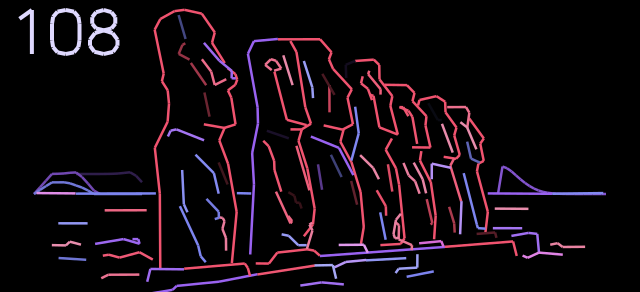

**home: cutoff open, little emphasis**

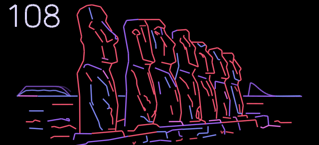

**home: the initial sound (000, Jestofunk bass), idle**

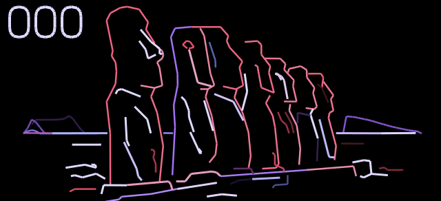

**home: 000 at rest (the number faded)**

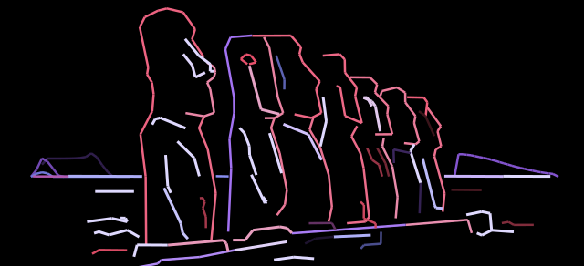

**home: the four knobs shown, at rest (knobs shown)**

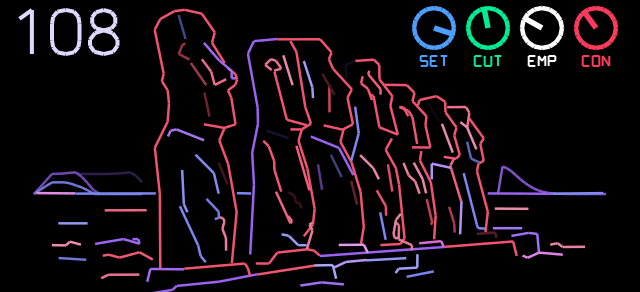

**home: all four knobs turning (turning 0123)**

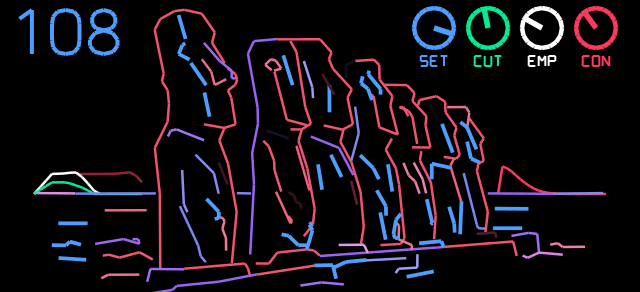

**home: 000, a note: the contour opens the filter**

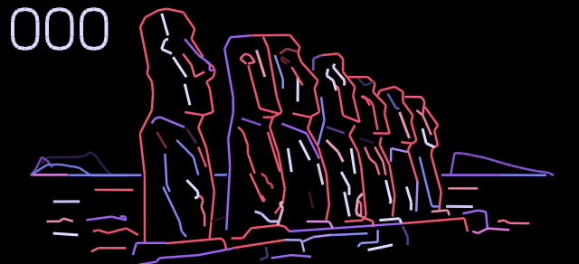

**home: cutoff 45 %, emphasis high**

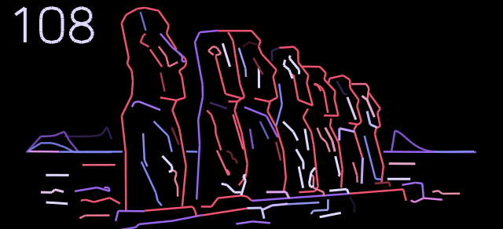

**home: cutoff closed**

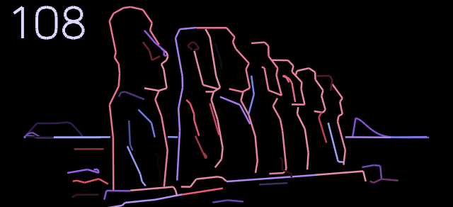

**home: detune, drift, noise (wind)**

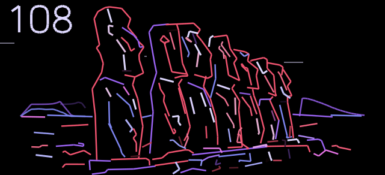

**home + Shift: DET DRV AMT SAT**

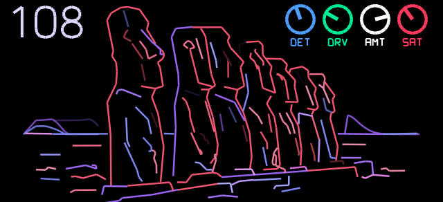

**home: cutoff knob (turning 1)**

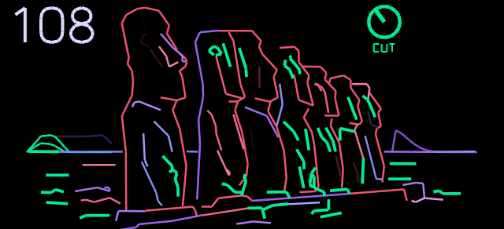

**home: emphasis knob (turning 2)**

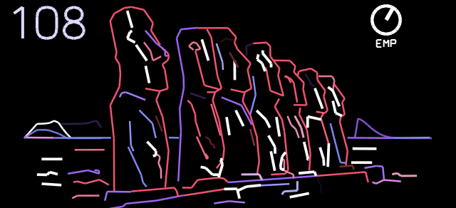

**home: contour knob (turning 3): a slow swell**

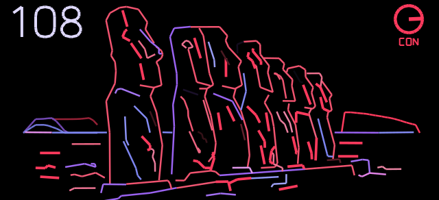

**home: contour knob (turning 3): a pluck**

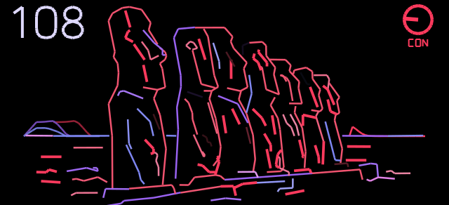

**home: cutoff at the top, emphasis high**

**home: 5 s untouched (the number faded)**

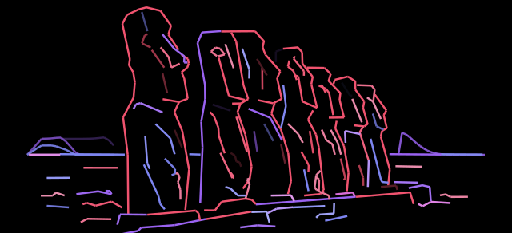

**home: contour 5 %**

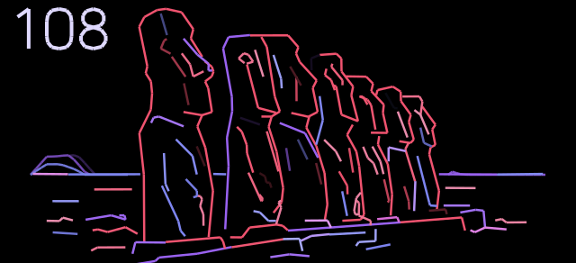

**home: contour 15 %**

**home: contour 25 %**

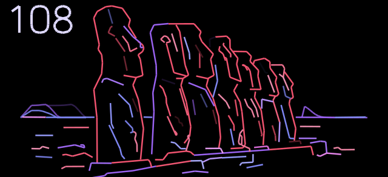

**home: contour 40 %**

**home: emphasis 30 %, cutoff 30 %**

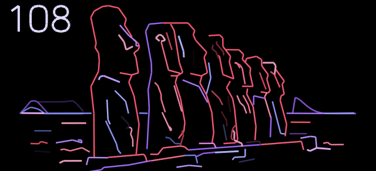

**home: emphasis full, cutoff 70 %**

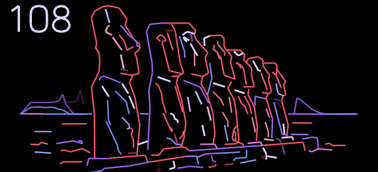

## advanced

**advanced (default highlights)**

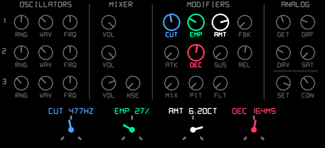

**advanced: highlights moved**

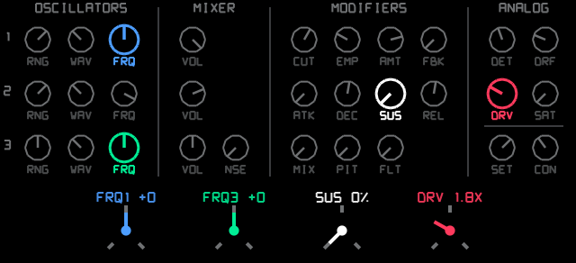

## osc 1

**osc 1 (MOOG BS), idle: the ideal shape**

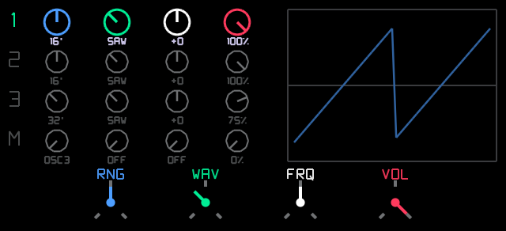

**osc 1 (MOOG BS), a note: the real output**

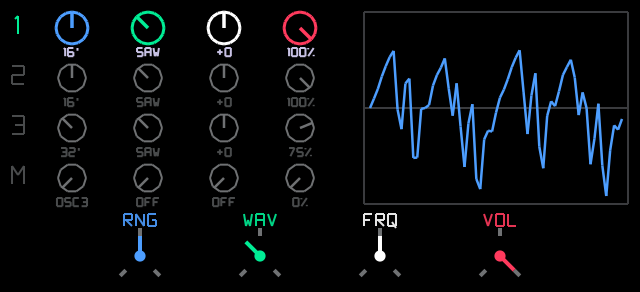

## osc 2

**osc 2 (5TH LEAD: 8' saw +7), a note**

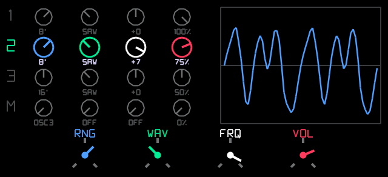

## osc 3

**osc 3 resting (poly)**

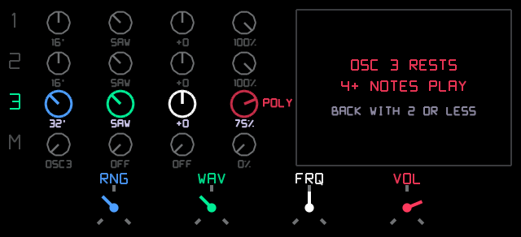

**osc 3 (CLARINET: 16' triangle)**

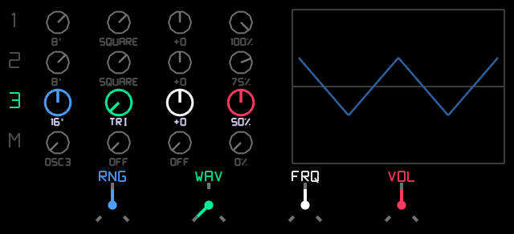

**osc 3 in LO (silent: the modulator), a note**

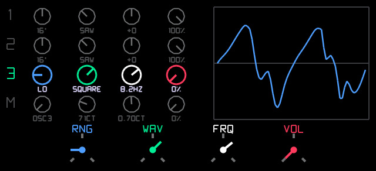

## filter

**filter, note held**

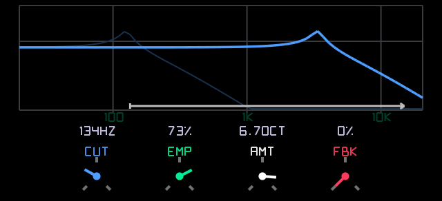

**filter: cutoff on a note (A4)**

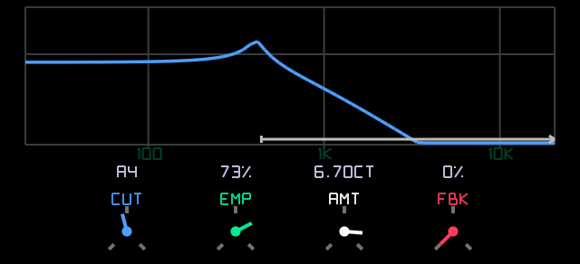

## contour

**contour (from the contour knob)**

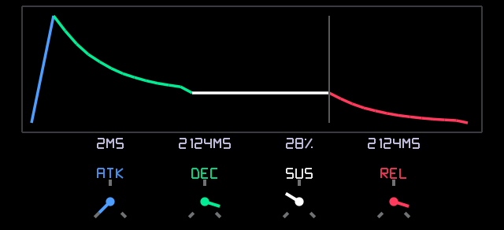

**contour: decay on the tempo (1/8)**

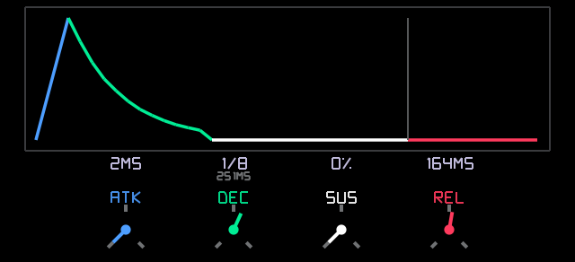

## analog

**analog: detune, drift, drive up**

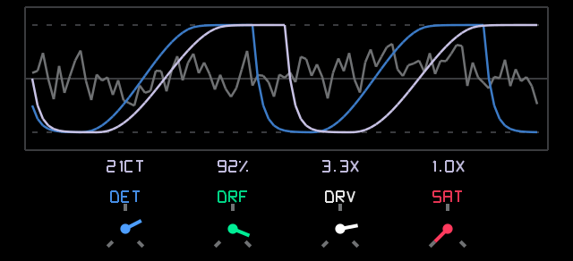

**analog: MOOG BS as set (three saws, 16' 16' 32')**

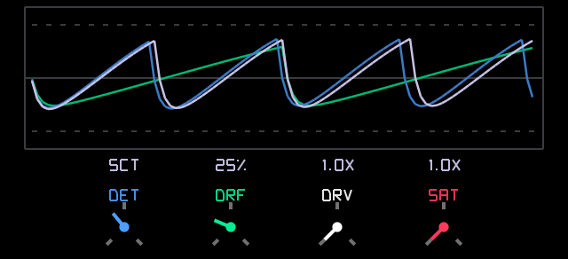

**analog: saturation up**

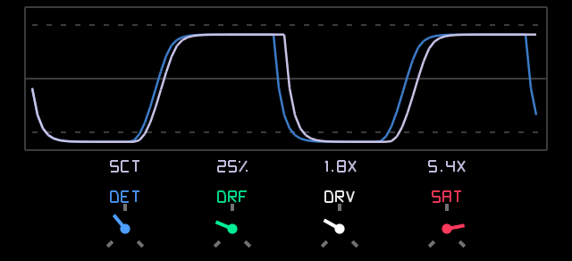

## noise / modulation row

**noise row (BREATH), a note**

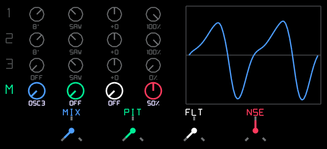

**modulation row: osc 3 LO, vibrato + wah**

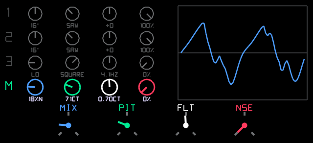

**modulation row: no source (osc 3 at 32')**

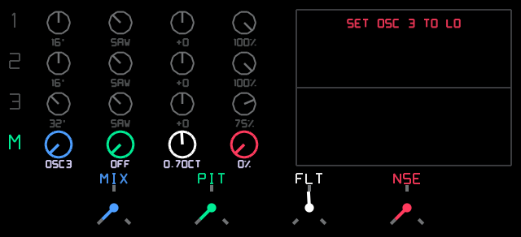
